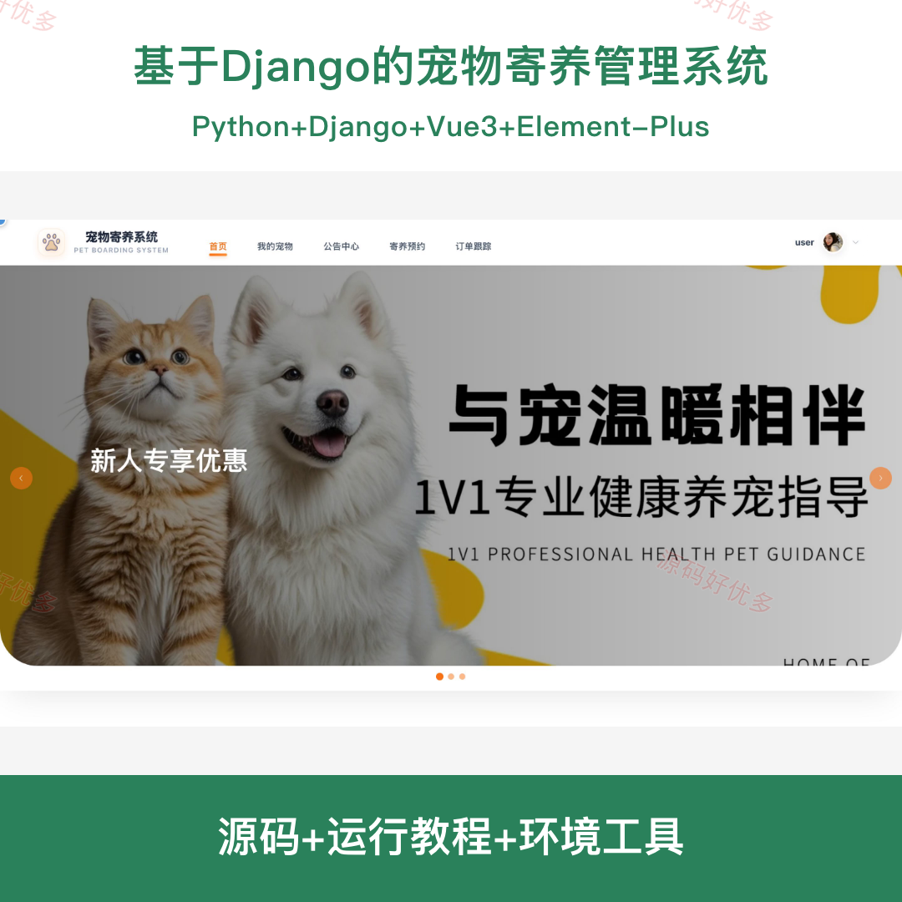
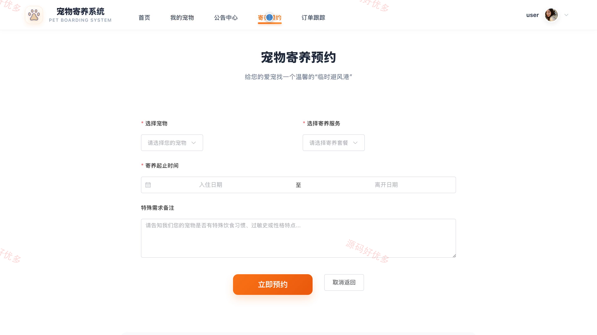
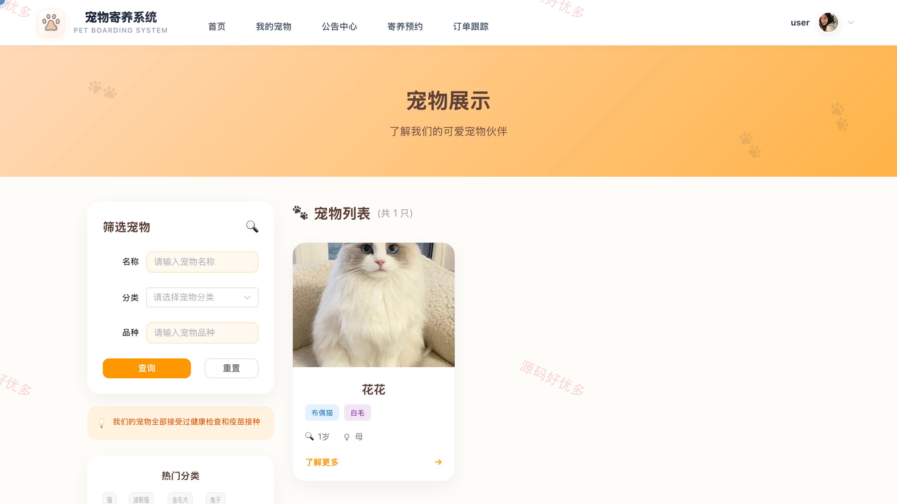
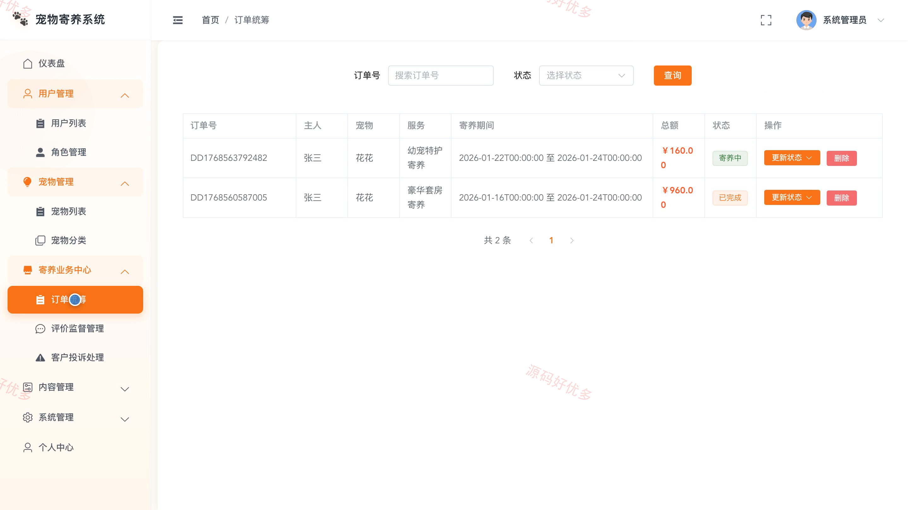
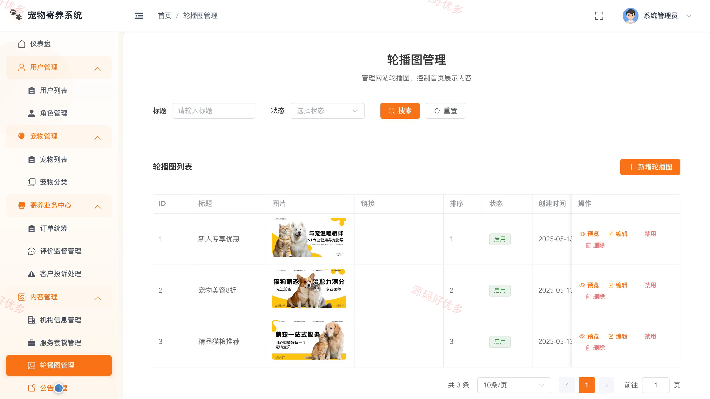
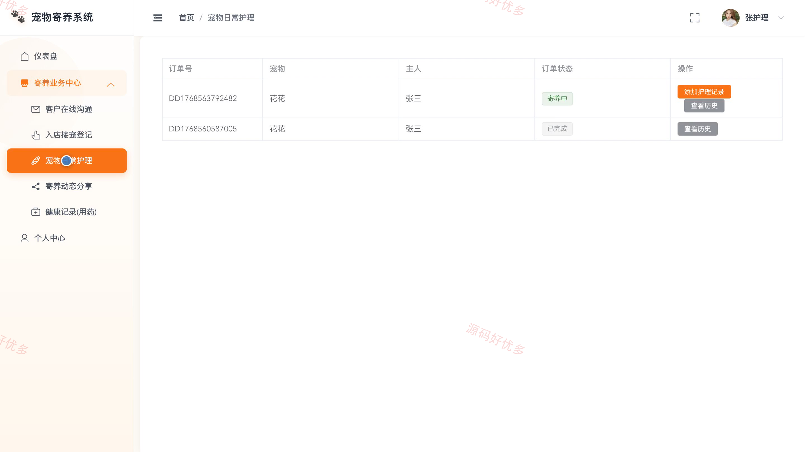

## 源码问题查看主页咨询

### 一、关键词
宠物寄养、宠物托管、寄养预约、宠物护理、寄养订单

### 二、作品包含
源码+数据库+全套环境和工具资源+本地部署教程

### 三、项目技术
前端技术： Html、Css、Js、Vue3.2、Element-Plus
后端技术：Python、Django

### 四、运行环境要求
开发工具：PyCharm + VSCODE

数据库：MySQL5.7+（共18张表）

数据库管理工具：Navicat10以上版本

环境配置软件： Python3.9+

前端Nodejs：16+

浏览器：谷歌浏览器

### 五、项目介绍
项目编号：bs129C

系统围绕宠物寄养服务，支持宠主查看宠物与服务信息、提交寄养预约、跟踪订单、评价服务并在线沟通；护理员处理接宠、日常护理、动态分享和健康记录；管理员维护用户、宠物、机构、服务与订单等业务数据。

角色：用户、宠物护理员、管理员

用户功能：宠物信息浏览、我的宠物管理、寄养预约、订单跟踪、服务评价、在线沟通。

宠物护理员功能：入店接宠登记、宠物日常护理、寄养动态分享、健康用药记录、客户在线沟通。

管理员功能：用户与角色管理、宠物与分类管理、机构与服务套餐管理、寄养订单统筹、客户投诉处理、评价监督、公告与轮播图管理、系统菜单管理。

### 六、运行截图

